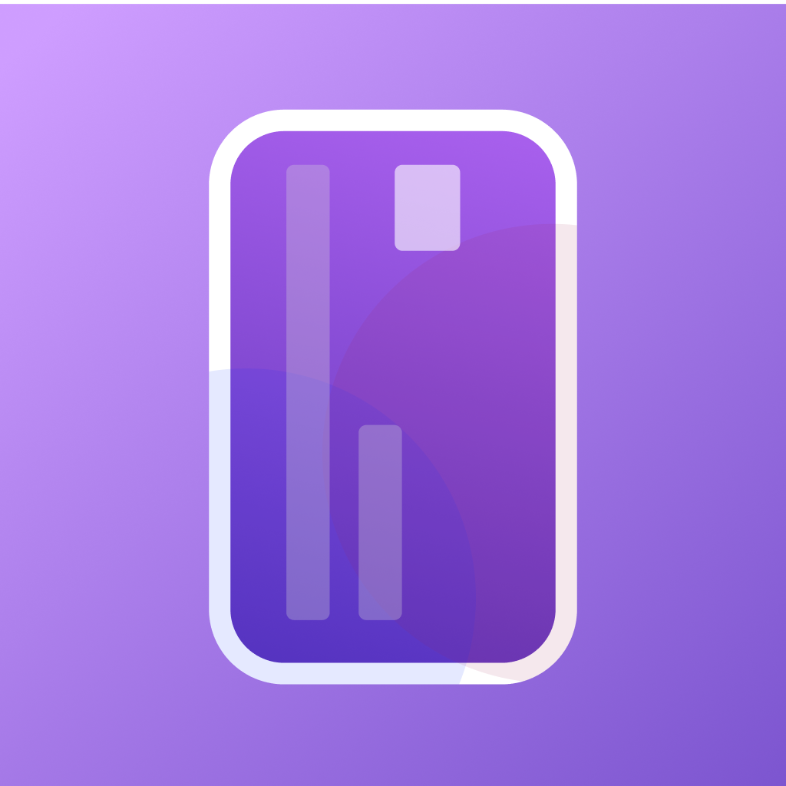
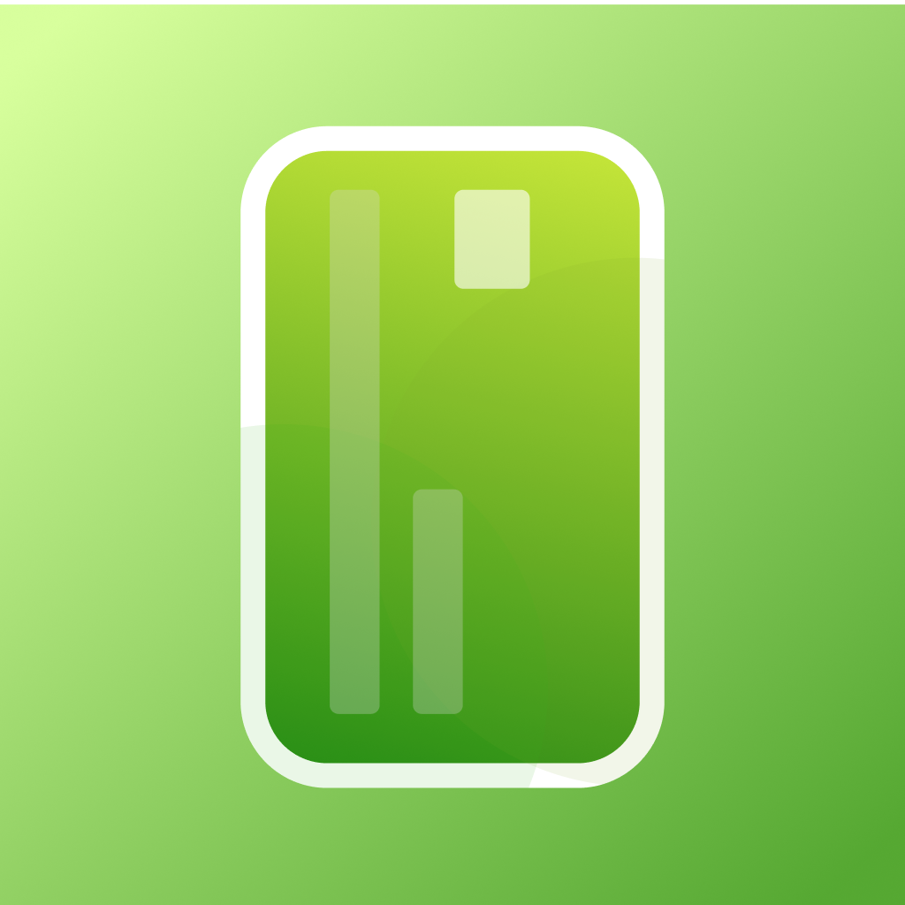

# Ícono anterior

Este era el ícono de la app antes del 17-10-2026, cuando iOS pasó a usar el ícono de Icon Composer (`assets/app.icon`).

- `icon.png`: ícono principal (1024×1024). Sigue siendo el `icon` general en `app.json`, así que Android y web lo usan todavía.
- `adaptive-icon.png`: primer plano del ícono adaptativo de Android.
- `favicon.png`: favicon de la web.

Para volver a usarlo en iOS, borra `"icon": "./assets/app.icon"` de la sección `ios` en `app.json`.

## Web

El 17-10-2026 la web también cambió al ícono verde nuevo, exportado de `moneyAppWeb.icon` con Icon Composer. Los anteriores están en `web/`:

- `web/apple-touch-icon.png`: el que se ve al agregar la web al inicio desde Safari (va en `public/`).
- `web/icon-web.png`: la versión 1024×1024 del mismo (va en `assets/`).
- `favicon.png` (arriba): el favicon anterior de la web.
